<!-- HEADER -->
<p align="center">
  
</p>

<p align="center">
  <a href="https://git.io/typing-svg">
    
  </a>
</p>

<p align="center">
  <a href="https://linkedin.com/in/muhammad-abdullah-noor"></a>
  <a href="mailto:abdullahqadoos8@gmail.com"></a>
  
</p>

---

## `$ whoami`

```yaml
name:      Muhammad Abdullah Noor
role:      AI Engineer — AI Agents & AI Automation
base:      Lahore, Pakistan
focus:     [multi-agent systems, workflow engines, RAG, end-to-end automation]
shipped:   [Unilever warehouse configurator, production planning automation, industrial RAG assistant]
mindset:   build it, break it, ship it
```

---

## `$ cat ./projects`

| Project | What it does |
|:--|:--|
| 🟧 [**Hivecell-Multiagent-Harness-Mesh**](https://github.com/abdullah-qadoos/Hivecell-Multiagent-Harness-Mesh) | Multi-agent coding harness with a built-in MCP coordination mesh |
| 🟧 [**dopple-pii-cii-redaction**](https://github.com/abdullah-qadoos/dopple-pii-cii-redaction) | Local PII and company-data redactor for CSV, JSON, SQL dumps and Excel, with format-preserving fakes and a leak scan |
| 🟧 [**Pivotra-Excel-Solutions-Powerbi-builder**](https://github.com/abdullah-qadoos/Pivotra-Excel-Solutions-Powerbi-builder) | AI fixes messy Excel layouts, then generates Power BI reports |
| 🟧 [**Ebay-listr**](https://github.com/abdullah-qadoos/Ebay-listr) | RAG eBay listing generator with vector search and competitor pricing |
| 🟧 [**AI-Powered-ERP**](https://github.com/abdullah-qadoos/AI-Powered-ERP) | Ask a flour mill ERP questions in Urdu or English, with an LLM turning them into SQL |
| 🟧 [**Pneumonia-Risk-Assistant**](https://github.com/abdullah-qadoos/Pneumonia-Risk-Assistant) | Two-stage pneumonia risk screening from wearable data, with an LLM and FastAPI |
| 🟧 [**Pears-analyzer**](https://github.com/abdullah-qadoos/Pears-analyzer) | AI GPU cost analyzer |

---

## `$ cat ./tech-stack`

**Languages**

<p>
  
  
  
  
  
</p>

**AI / ML**

<p>
  
  
  
  
  
  
  
  
</p>

**AI Tools & Models**

<p>
  
  
  
  
  
  
  
  
  
  
  
  
  
  
  
  
</p>

**Agents & Automation**

<p>
  
  
  
  
  
</p>

**Backend & Data**

<p>
  
  
  
  
  
  
</p>

**Industrial Automation**

<p>
  
  
  
  
</p>

**Tools & DevOps**

<p>
  
  
  
  
  
</p>

---

<p align="center">
  
</p>
